# AgendaFácil

Sistema web de **agendamento online para barbearias e salões**. O cliente escolhe o serviço, vê os horários livres e marca o atendimento sem precisar trocar mensagens; o estabelecimento acompanha a agenda do dia e gerencia os serviços oferecidos.

> Frontend em **React** (Vite + React Router).
> Fase 1: os dados são simulados em `src/services/mockApi.js` (com atraso e códigos HTTP, como uma API REST real).

---

## 1. Identificação

| Item | Descrição |
|---|---|
| **Projeto** | AgendaFácil |
| **Disciplina** | Criar Serviços Web com REST |
| **Tipo** | Aplicação web (SPA) |
| **Frontend** | React 19, Vite |

### Integrantes

| Nome completo | E-mail | Papel / Responsabilidade |
|---|---|---|
| Gabriel Barbosa Claudino | gabrielbarbosabusinesscg@gmail.com | **Líder técnico · Arquitetura e rotas.** Estrutura de pastas do projeto, configuração do React Router (`App.jsx`), proteção de rotas (`routes/RotaPrivada.jsx`), contexto de autenticação (`context/AuthContext.jsx`) e layout compartilhado (`Layout.jsx`, `Navbar.jsx`). |
| João Lucas Pereira Guimarães | joaolucaspg0701@gmail.com | **Autenticação.** Telas de Login e Cadastro (`pages/Login.jsx`, `pages/Cadastro.jsx`), validações dos formulários de acesso e componentes de formulário (`CampoFormulario.jsx`, `CampoSenha.jsx`, `LayoutAutenticacao.jsx`). |
| Lucas Emanuel Souza Figueiredo | lfigueiredo2222@gmail.com | **Catálogo e agendamento.** Listagem de serviços com filtros e paginação (`pages/Servicos.jsx`, `ServicoCard.jsx`, `Paginacao.jsx`) e formulário de novo agendamento/reagendamento com cálculo de horários livres (`pages/AgendamentoForm.jsx`). |
| Maria Clara Araujo Fernandes | mariaclaraaf70@gmail.com | **Área do cliente e UX.** Tela "Meus agendamentos" (cancelar e reagendar), estados de interface · carregamento, erro, sucesso e lista vazia (`Carregando.jsx`, `MensagemErro.jsx`, `MensagemSucesso.jsx`, `SeloStatus.jsx`) · e identidade visual (`index.css`, `App.css`). |
| Victor David Inocencio Soares | victordavidis74@gmail.com | **Área administrativa e dados.** Painel do estabelecimento (`pages/PainelAdmin.jsx`), gestão de serviços (`pages/GerenciarServicos.jsx`, `pages/ServicoForm.jsx`), modelagem de dados, API simulada (`services/mockApi.js`, `data/dadosIniciais.js`) e cliente HTTP (`services/api.js`). |

---

## 2. Escopo · Definição da Aplicação

### Problema
Barbearias e salões de pequeno porte normalmente marcam horários por WhatsApp, telefone ou caderno. Isso gera **troca de mensagens demorada**, **horários marcados em duplicidade**, **esquecimentos** e nenhuma visão organizada da agenda do dia. O cliente não sabe quais horários estão livres sem perguntar, e o profissional perde tempo respondendo mensagens durante o atendimento.

### Solução
O AgendaFácil centraliza a agenda em um site:
- o **cliente** vê os serviços (preço e duração), escolhe a data e um **horário livre calculado automaticamente**, e acompanha, reagenda ou cancela seus agendamentos;
- o **estabelecimento (admin)** vê a agenda do dia, confirma, conclui ou cancela atendimentos, e cadastra/edita/desativa os serviços.

### Público-alvo
- **Clientes** de barbearias e salões que querem marcar horário pelo celular ou computador, a qualquer hora.
- **Donos e funcionários** de estabelecimentos pequenos (1 a poucos profissionais) que precisam organizar a agenda sem um sistema caro.

### Contexto de uso
- O cliente acessa principalmente pelo **celular** (layout responsivo), muitas vezes logo antes de marcar · por isso o fluxo de agendamento tem 3 passos (serviço → data → horário) e um resumo fixo.
- O admin usa no **balcão/computador** ao longo do dia, para ver quem vem a seguir e atualizar o status de cada atendimento.

### Funcionalidades (escopo)
| Perfil | Funcionalidade |
|---|---|
| Visitante | Ver catálogo de serviços com busca e filtro por preço; criar conta; entrar |
| Cliente | Novo agendamento com horários livres; listar "Meus agendamentos" com filtro por status; reagendar; cancelar (até 2 h antes) |
| Admin | Painel com agenda filtrada por data e status, contadores, confirmar/concluir/cancelar; CRUD de serviços com ativar/desativar |

**Fora do escopo nesta fase:** pagamento online, notificações por e-mail/WhatsApp, vários profissionais com agendas separadas.

---

## 3. Modelagem de Dados

### Diagrama (Entidade-Relacionamento)

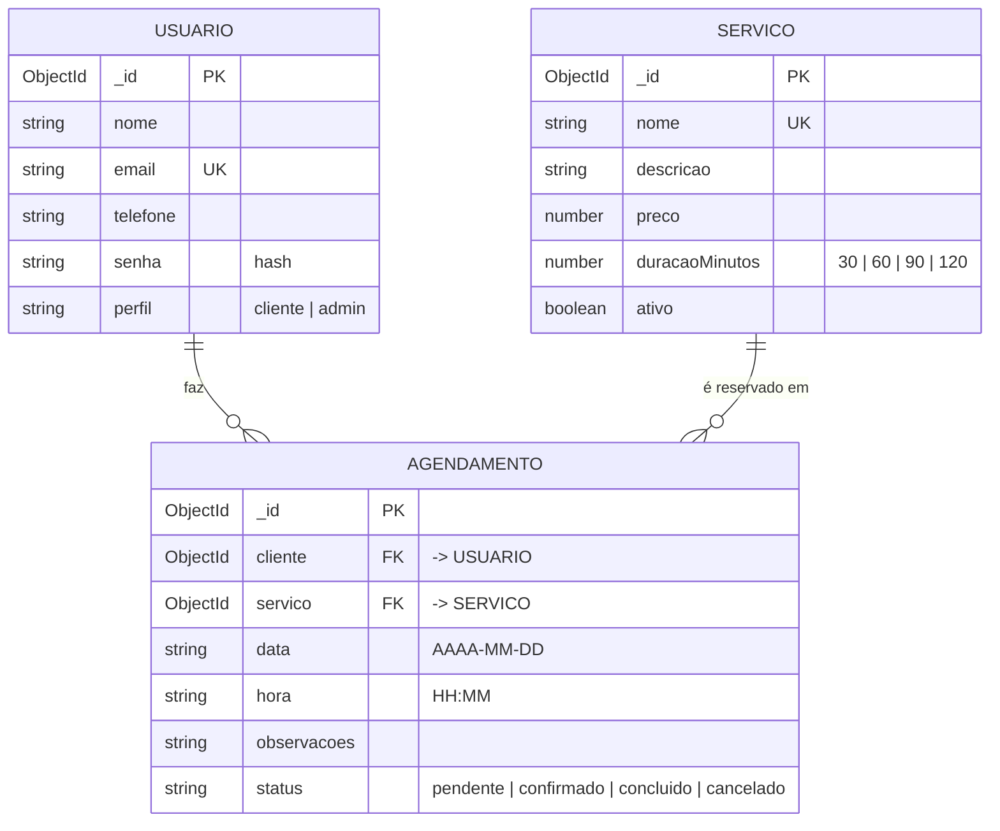

Em texto: **Usuário (1) ⟷ (N) Agendamento (N) ⟷ (1) Serviço**.

### Entidades

**Usuário** · quem usa o sistema. O campo `perfil` define o acesso: `cliente` (agenda horários) ou `admin` (o estabelecimento).

**Serviço** · o que o estabelecimento oferece (ex.: "Corte masculino", R$ 35,00, 30 min). A duração define quantos horários o atendimento ocupa.

**Agendamento** · a reserva de um serviço por um cliente em uma data e hora. É a entidade que liga as outras duas.

### Relacionamentos
| Relação | Cardinalidade | Explicação |
|---|---|---|
| Usuário → Agendamento | 1 : N | Um cliente pode ter vários agendamentos; cada agendamento pertence a um único cliente (`agendamento.cliente`). |
| Serviço → Agendamento | 1 : N | Um serviço pode ser reservado várias vezes; cada agendamento é de um único serviço (`agendamento.servico`). |

Exemplo de agendamento (como a API devolve, com `cliente` e `servico` "populados"):
```json
{
  "_id": "a2",
  "cliente": { "_id": "u4", "nome": "Carlos Lima", "telefone": "(83) 96666-3333" },
  "servico": { "_id": "s3", "nome": "Corte + barba", "preco": 55, "duracaoMinutos": 60 },
  "data": "2026-11-06",
  "hora": "10:30",
  "observacoes": "Barba mais curta",
  "status": "confirmado"
}
```

### Regras de negócio
1. **E-mail único:** não pode existir duas contas com o mesmo e-mail (erro 409).
2. **Perfis:** todo cadastro feito pelo site é `cliente`. Só `admin` acessa `/admin/*` e altera serviços.
3. **Nome de serviço único** e **preço maior que zero**; duração em múltiplos de 30 min (30, 60, 90 ou 120).
4. **Horário de funcionamento:** das 09:00 às 18:00, com horários a cada 30 min. Um serviço de 60 min às 17:30 não aparece porque terminaria depois das 18:00.
5. **Sem conflito de horário:** um horário só é livre se o intervalo `[hora, hora + duração)` não se sobrepõe a nenhum agendamento não cancelado da mesma data. Agendamentos cancelados liberam o horário.
6. **Sem datas ou horários passados:** a data deve ser hoje ou depois; no dia de hoje, horários que já passaram ficam indisponíveis.
7. **Fluxo de status:** `pendente → confirmado → concluido`; `pendente` ou `confirmado → cancelado`. Concluído e cancelado são finais.
8. **Quem muda o status:** o admin confirma, conclui e cancela; o cliente só pode **cancelar** os próprios agendamentos, e somente com **no mínimo 2 horas de antecedência**.
9. **Reagendar:** só o dono do agendamento, só se estiver pendente ou confirmado; ao reagendar o status volta para `pendente` para o estabelecimento confirmar de novo.
10. **Serviço com agendamentos futuros não pode ser removido** (erro 409) · deve ser **desativado** (`ativo: false`), o que o tira do catálogo sem apagar o histórico.

---

## 4. Especificação de Frontend

### Estrutura de pastas
```
agendafacil/
├── public/
│   └── favicon.png
├── src/
│   ├── components/
│   │   ├── CampoFormulario.jsx
│   │   ├── CampoSenha.jsx
│   │   ├── Carregando.jsx
│   │   ├── Layout.jsx
│   │   ├── LayoutAutenticacao.jsx
│   │   ├── Logo.jsx
│   │   ├── MensagemErro.jsx
│   │   ├── MensagemSucesso.jsx
│   │   ├── Navbar.jsx
│   │   ├── Paginacao.jsx
│   │   ├── SeloStatus.jsx
│   │   └── ServicoCard.jsx
│   ├── context/
│   │   └── AuthContext.jsx
│   ├── data/
│   │   └── dadosIniciais.js
│   ├── images/
│   │   └── logoAgendaFacil.png
│   ├── pages/
│   │   ├── AgendamentoForm.jsx
│   │   ├── Agendamentos.jsx
│   │   ├── Cadastro.jsx
│   │   ├── GerenciarServicos.jsx
│   │   ├── Home.jsx
│   │   ├── Login.jsx
│   │   ├── NaoEncontrada.jsx
│   │   ├── PainelAdmin.jsx
│   │   ├── ServicoForm.jsx
│   │   └── Servicos.jsx
│   ├── routes/
│   │   └── RotaPrivada.jsx
│   ├── services/
│   │   ├── api.js
│   │   └── mockApi.js
│   ├── App.css
│   ├── App.jsx
│   ├── index.css
│   └── main.jsx
├── docs/telas/          (capturas de tela usadas neste README)
├── .gitignore
├── eslint.config.js
├── index.html
├── package.json
├── README.md
└── vite.config.js
```

### Mapeamento de Rotas (React Router)

| Rota | Página (`src/pages`) | Acesso | Descrição |
|---|---|---|---|
| `/` | `Home.jsx` | Público | Boas-vindas e atalhos conforme o perfil |
| `/login` | `Login.jsx` | Público | Entrar na conta; volta para a página que o usuário tentou abrir |
| `/cadastro` | `Cadastro.jsx` | Público | Criar conta de cliente |
| `/servicos` | `Servicos.jsx` | Público | Catálogo com busca, filtro de preço e paginação |
| `/agendamentos` | `Agendamentos.jsx` | Logado | "Meus agendamentos" com filtro por status, cancelar e reagendar |
| `/agendamentos/novo` | `AgendamentoForm.jsx` | Logado | Novo agendamento (aceita `?servico=ID` para vir com o serviço escolhido) |
| `/agendamentos/:id/editar` | `AgendamentoForm.jsx` | Logado (dono) | Reagendar: trocar serviço, data e horário |
| `/admin/painel` | `PainelAdmin.jsx` | Admin | Agenda do dia com filtros por data e status, contadores e ações |
| `/admin/servicos` | `GerenciarServicos.jsx` | Admin | Tabela de serviços: editar, ativar/desativar, remover |
| `/admin/servicos/novo` | `ServicoForm.jsx` | Admin | Cadastrar serviço |
| `/admin/servicos/:id/editar` | `ServicoForm.jsx` | Admin | Editar serviço |
| `*` | `NaoEncontrada.jsx` | Público | Página 404 |

**Proteção:** as rotas "Logado" e "Admin" ficam dentro de `<RotaPrivada />`. Sem login → redireciona para `/login` guardando a rota de origem; logado sem o perfil exigido → redireciona para `/servicos`.

### Mockups / Telas

Capturas da aplicação rodando (pasta `docs/telas/`).

**Login**
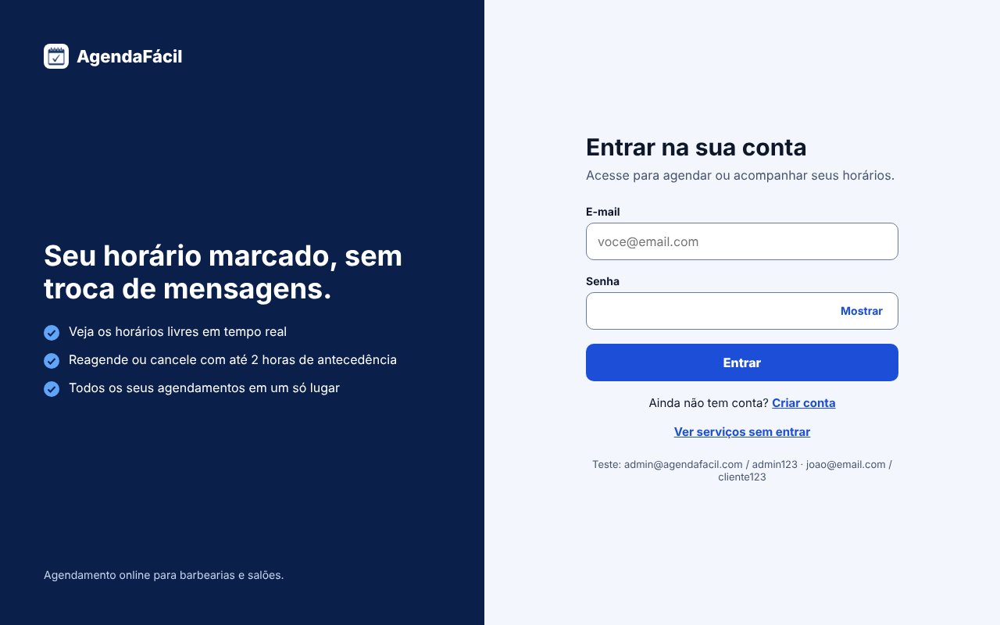

**Cadastro (com validação)**
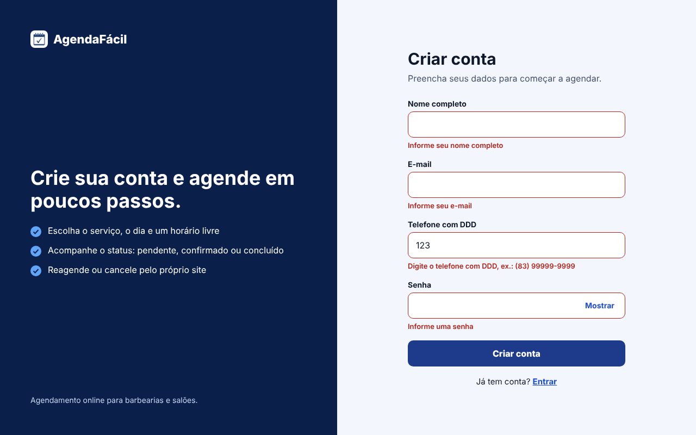

**Listagem de serviços com filtros**
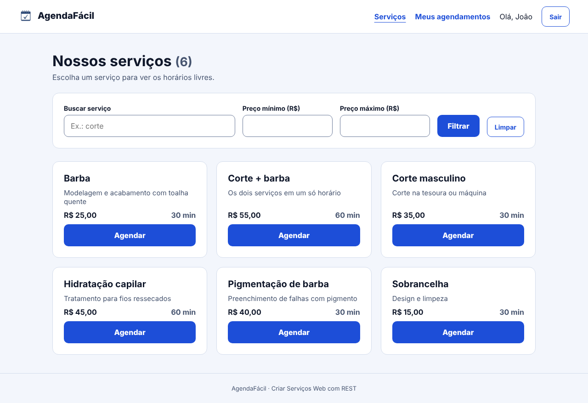

**Formulário de novo agendamento**
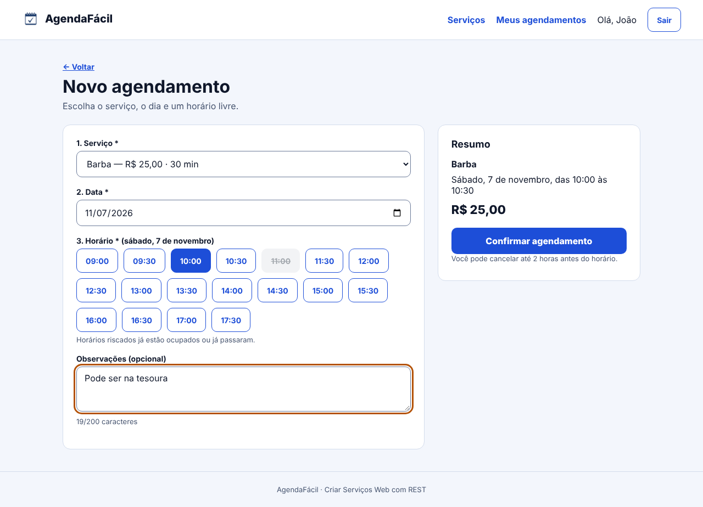

**Meus agendamentos (cliente)**
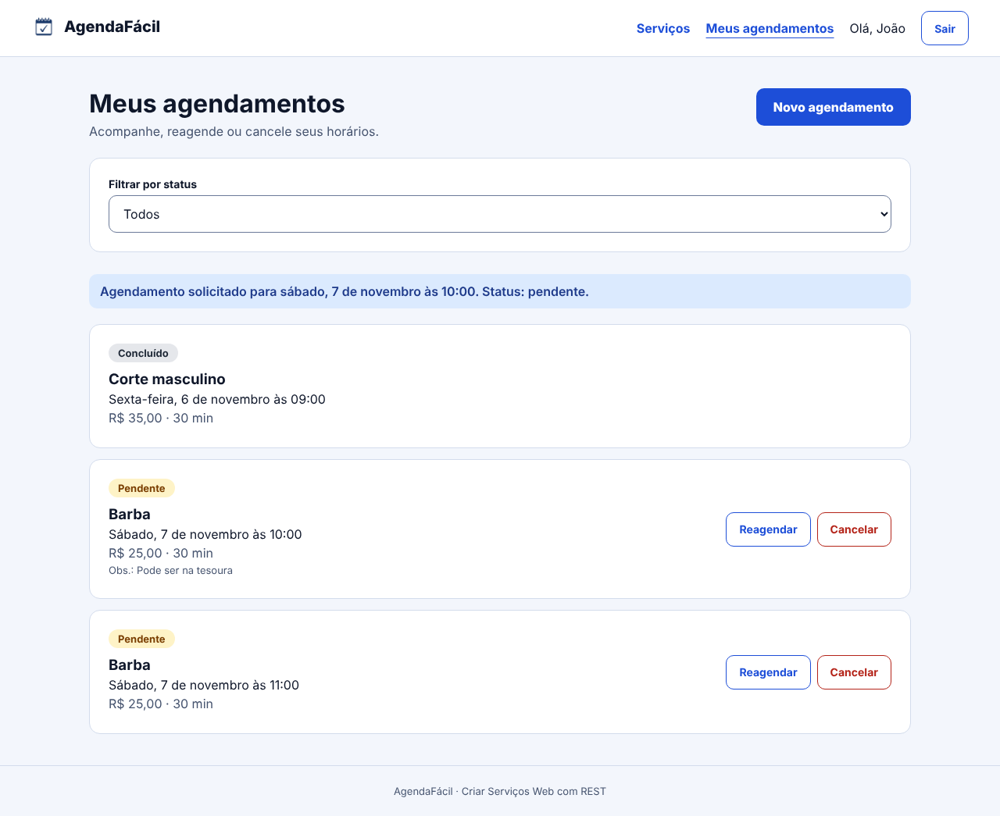

**Reagendar (edição de agendamento)**
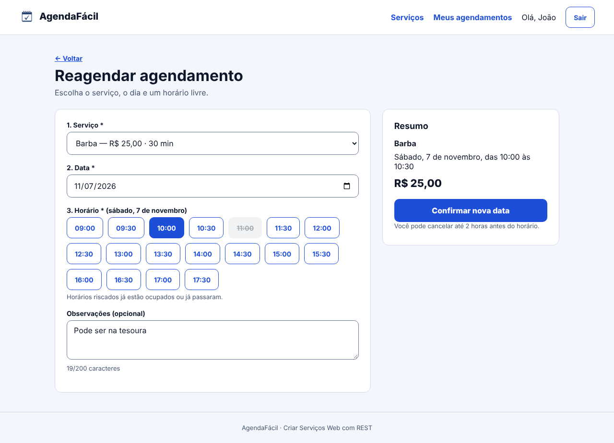

**Painel do administrador (dashboard com filtros)**
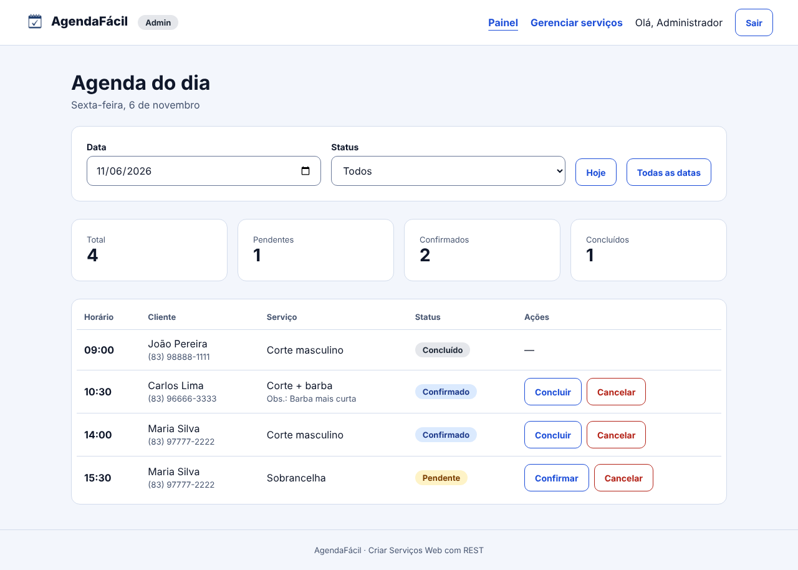

**Gerenciar serviços (listagem admin)**
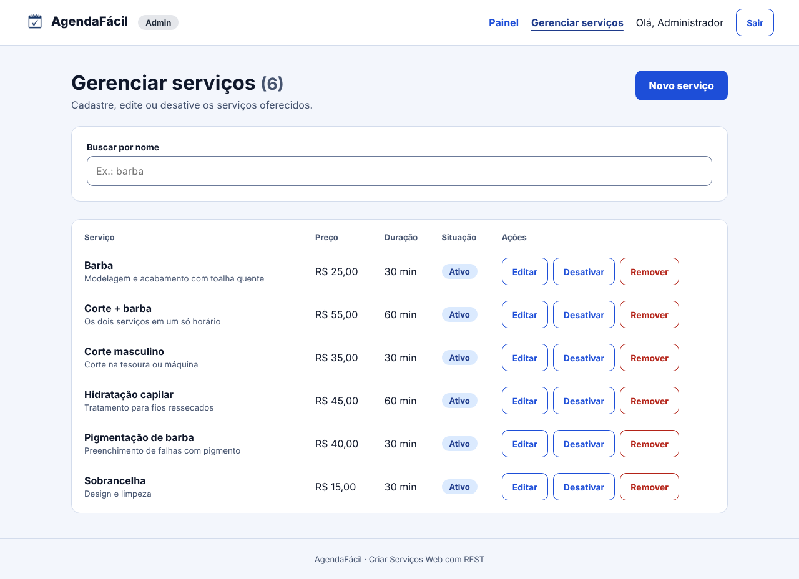

**Cadastro / edição de serviço**
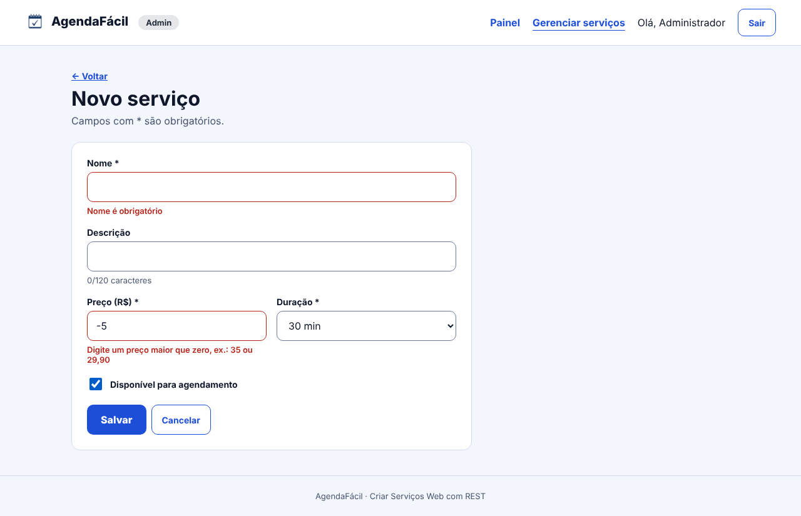
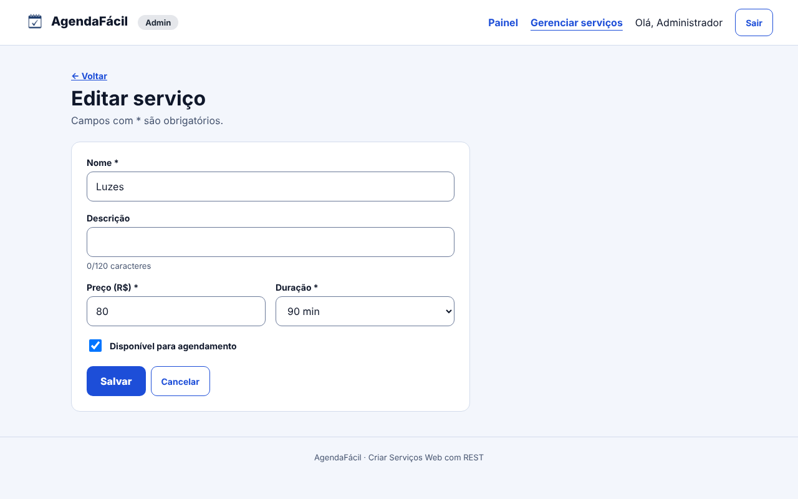

**Página não encontrada (404)**
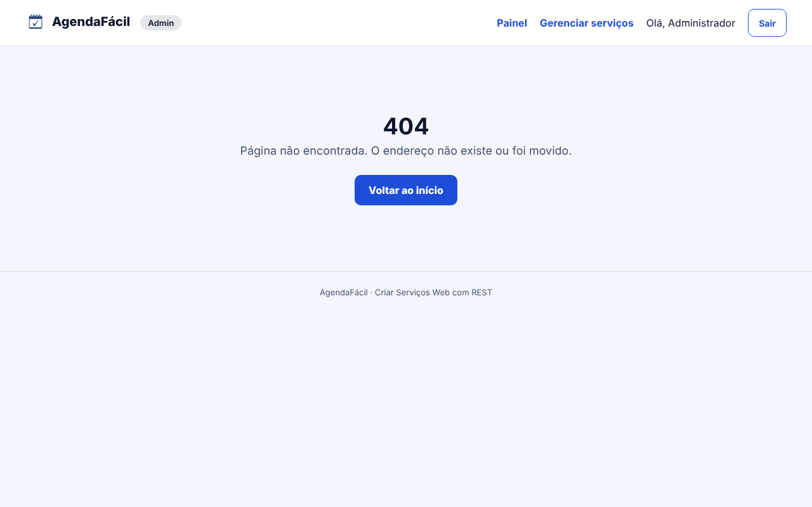

---

### UX & Estados da Interface

#### Validações nos formulários
Todos os formulários usam `noValidate` e validam no `handleSubmit` **antes** de chamar a API. O erro aparece **logo abaixo do campo**, em vermelho, com a borda do campo destacada (`aria-invalid` + `aria-describedby` para leitores de tela). Ao corrigir o campo a mensagem some.

| Formulário | Campo | Regra | Mensagem |
|---|---|---|---|
| Login | E-mail | obrigatório | "Informe seu e-mail" |
| | | formato `nome@dominio.com` | "Digite um e-mail válido" |
| | Senha | obrigatória | "Informe a senha" |
| | | mínimo 6 caracteres | "A senha deve ter no mínimo 6 caracteres" |
| Cadastro | Nome | obrigatório | "Informe seu nome completo" |
| | | nome e sobrenome | "Digite nome e sobrenome" |
| | E-mail | obrigatório / formato | "Informe seu e-mail" / "Digite um e-mail válido" |
| | Telefone | obrigatório | "Informe seu telefone com DDD" |
| | | 10 ou 11 dígitos | "Digite o telefone com DDD, ex.: (83) 99999-9999" |
| | Senha | obrigatória / mínimo 6 | "Informe uma senha" / "A senha deve ter no mínimo 6 caracteres" |
| Agendamento | Serviço | obrigatório | "Selecione um serviço" |
| | Data | obrigatória / não pode ser passada | "Escolha uma data" / "Escolha uma data a partir de hoje" |
| | Horário | obrigatório | "Escolha um horário livre" |
| | Observações | até 200 caracteres (contador ao vivo) | "Use no máximo 200 caracteres" |
| Serviço (admin) | Nome | obrigatório / mín. 3 caracteres | "Nome é obrigatório" / "O nome deve ter pelo menos 3 caracteres" |
| | Descrição | até 120 caracteres | "Use no máximo 120 caracteres" |
| | Preço | obrigatório, número > 0 (aceita vírgula) | "Preço é obrigatório" / "Digite um preço maior que zero, ex.: 35 ou 29,90" |
| | Duração | uma das opções | "Selecione a duração" |
| Filtro de serviços | Preço mín./máx. | só números; mínimo ≤ máximo | "Digite apenas números nos preços…" / "O preço mínimo não pode ser maior que o máximo" |

#### Erros vindos da API
Erros de regra de negócio ou de comunicação aparecem num **alerta vermelho no topo do formulário/lista** (`MensagemErro.jsx`, `role="alert"`). Os dados digitados **não são apagados**, para o usuário só corrigir e tentar de novo.

| Situação | Código | Mensagem exibida |
|---|---|---|
| Login inválido | 401 | "E-mail ou senha incorretos. Confira os dados e tente novamente." |
| E-mail já cadastrado | 409 | "Já existe uma conta com esse e-mail." |
| Horário ocupado por outra pessoa enquanto o cliente escolhia | 409 | "Esse horário acabou de ser ocupado. Escolha outro." (a lista de horários é recarregada) |
| Nome de serviço repetido | 409 | "Já existe um serviço com esse nome." |
| Remover serviço com agendamentos futuros | 409 | "Este serviço tem agendamentos futuros. Desative-o em vez de remover." |
| Cancelar com menos de 2 h | 422 | "O cancelamento só é permitido com 2 horas de antecedência." |
| Registro inexistente | 404 | "Serviço não encontrado." / "Agendamento não encontrado." |
| Servidor fora do ar / sem internet | 503 / rede | "Não foi possível conectar ao servidor. Verifique sua internet e tente novamente." + botão **Tentar novamente** |
| Sessão expirada (Fase 2) | 401 | `api.js` limpa o token e redireciona para `/login` |

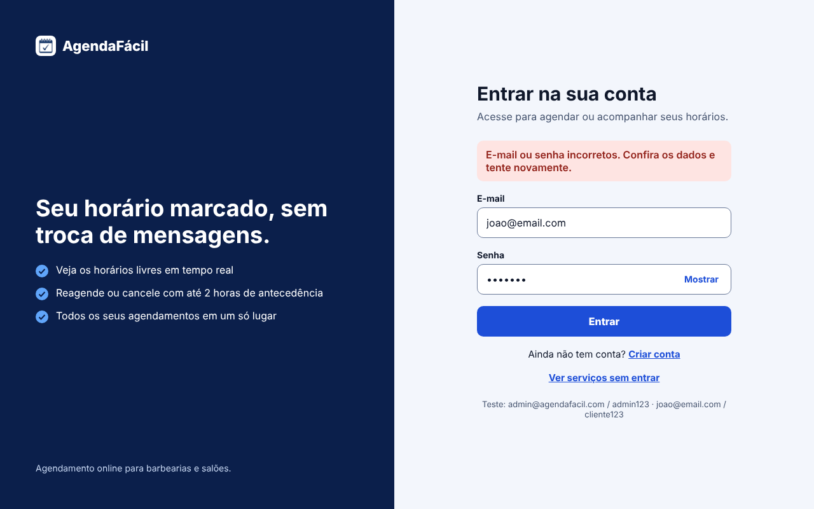
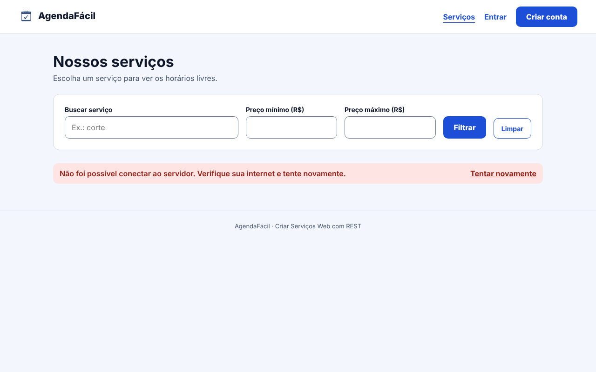

#### Estados de carregamento (loading)
- **Listas** (serviços, meus agendamentos, painel, gerenciar serviços): enquanto a requisição não volta, aparece o componente `Carregando` (spinner + texto, `role="status"`), por exemplo "Buscando serviços...". Os contadores do painel mostram "·".
- **Horários livres:** ao trocar serviço ou data, só a área de horários mostra "Buscando horários livres...", sem travar o resto do formulário.
- **Botões de envio** ficam **desabilitados** e mudam o texto durante o envio ("Entrando...", "Criando conta...", "Salvando...", "Cancelando..."), evitando clique duplo e agendamento repetido.
- **Formulários de edição** (reagendar, editar serviço) mostram "Carregando..." até os dados atuais chegarem.
- Cada `useEffect` usa a flag `ativo` para não atualizar o estado de um componente que já foi desmontado.

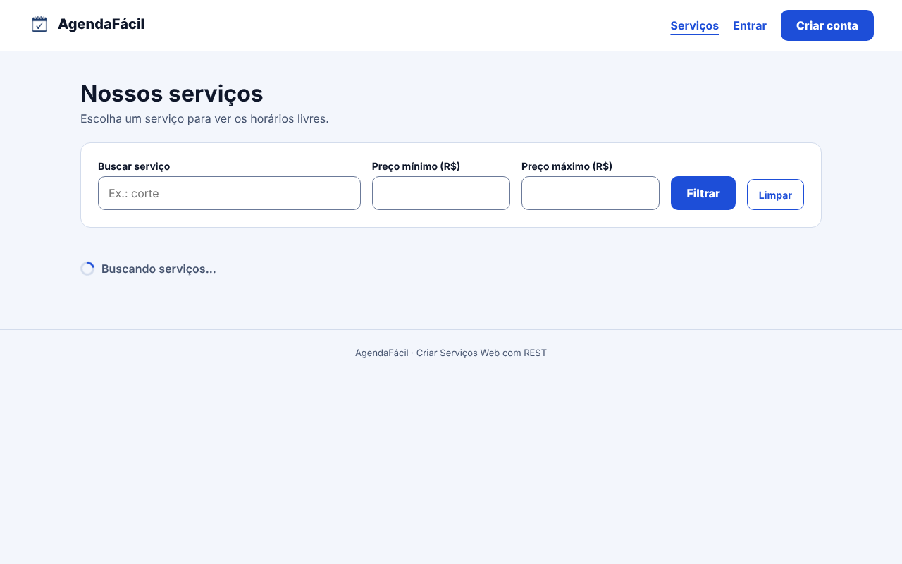

#### Estados vazios e de sucesso
- **Lista vazia:** caixa tracejada com orientação · "Nenhum serviço encontrado. Ajuste a busca ou os preços.", "Você ainda não tem agendamentos. Ver serviços", "Não há horários livres nesta data. Escolha outro dia."
- **Sucesso:** faixa azul (`MensagemSucesso.jsx`, `role="status"`) após agendar, reagendar, cancelar ou salvar serviço · ex.: "Agendamento solicitado para sábado, 7 de novembro às 10:00. Status: pendente."
- **Ações destrutivas** (cancelar agendamento, remover serviço) pedem confirmação antes.
- **Horários indisponíveis** aparecem riscados e desabilitados; o botão "Cancelar" fica desabilitado (com dica) quando faltam menos de 2 h.

---

## 5. Como executar

```bash
npm install
npm run dev
```
Abra o endereço mostrado no terminal (normalmente http://localhost:5173).

| Perfil | E-mail | Senha |
|---|---|---|
| Admin | admin@agendafacil.com | admin123 |
| Cliente | joao@email.com | cliente123 |
| Cliente | maria@email.com | cliente123 |

Também é possível criar uma conta nova em **Criar conta**.

**Demonstrar o estado de erro:** no console do navegador (F12) rode `localStorage.setItem('af_simular_falha', '1')` e recarregue. Para voltar ao normal: `localStorage.removeItem('af_simular_falha')`.

**Zerar os dados de exemplo:** `localStorage.clear()` no console.

Outros comandos: `npm run build` (gera a pasta `dist`), `npm run lint` (verifica o código).
